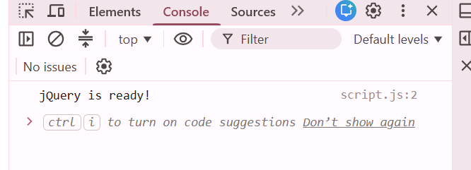
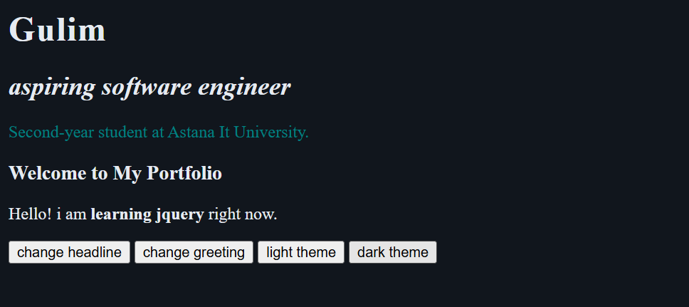
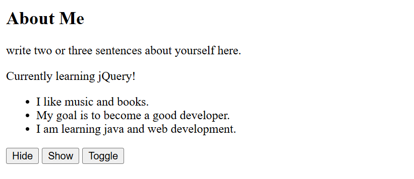
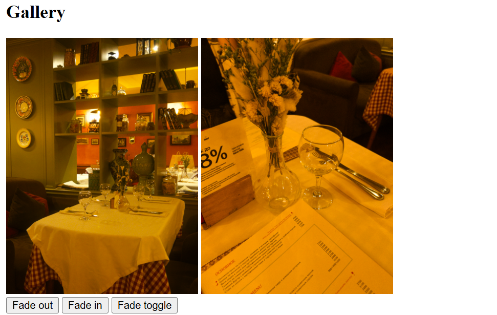
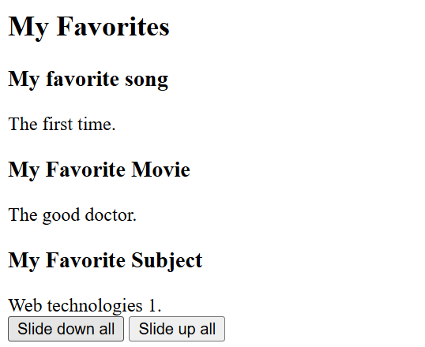
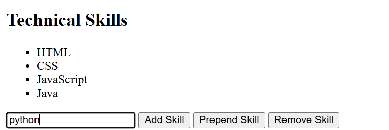
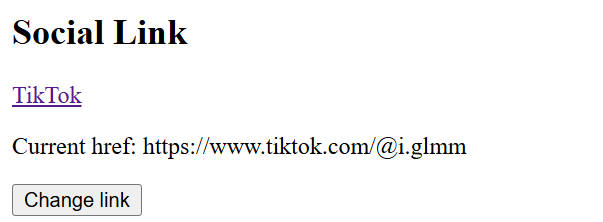
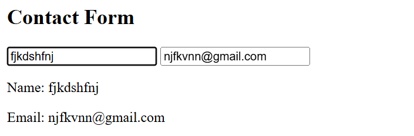
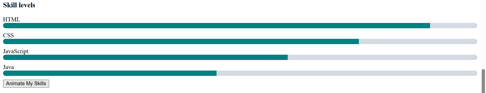

# Assignment 6. jQuery (Selectors, Effects, Animations)

Name: Gulim Zhumabay
Group: SE-2539

## Part 1. Getting Started with jQuery

### Task 0. Setup

In this task I connected jQuery from a CDN in the head of my html file. Then I wrote the document ready function in script.js and printed "jQuery is ready!" in the console. I opened the console to check that it works.

### Task 1. Selectors and CSS

I made the top part of my portfolio with my name, my headline, a short intro and the title "Welcome to My Portfolio". I used a tag selector for h1, a class selector for the intro and an id selector for the headline, and changed their styles with .css(). I also made two buttons that change the headline with .text() and the greeting with .html(). The greeting button shows the difference well, because with .html() the words "learning jquery" become bold. At the end I added light and dark theme buttons that change the background and text color of the page.

## Part 2. jQuery Effects

### Task 2. Visibility Methods

I created the About Me section with a short bio, a status message and a list of facts about me. There are three buttons: Hide, Show and Toggle. They control the status and the facts list. Hide makes them disappear, Show brings them back and Toggle switches between the two.

### Task 3. Fade Methods

I added two pictures to the gallery. There are three buttons for them: Fade out uses .fadeOut(), Fade in uses .fadeIn() and Fade toggle uses .fadeToggle(). The pictures disappear and appear smoothly.

### Task 4. Slide Methods

I made three clickable headings: my favorite song, movie and subject. Under each heading there is a hidden panel with the answer. When I click a heading, its own panel opens or closes with .slideToggle(). I also added two buttons, Slide down all and Slide up all, which use .slideDown() and .slideUp() on all panels.

## Part 3. DOM Manipulation with jQuery

### Task 5. Add and Remove Elements

I made a list of four technical skills: HTML, CSS, JavaScript and Java. Under it there is an input and three buttons. Add Skill puts a new skill at the end of the list with .append(), Prepend Skill puts it at the beginning with .prepend() and Remove Skill deletes the last skill with .remove(). If the input is empty, the skill is not added and a message "Please type a skill first." appears.

### Task 6. Modifying Attributes

I added a link to my Instagram. The Change link button changes the href of this link to my TikTok with .attr(), and also changes the text of the link. Under the link I show the current href, so it is easy to see that it changed.

### Task 7. Form Interaction

I made a form with Name and Email inputs. While the user types, the text is shown under the form at the same moment. For this I used the input event, .val() to get the value from the field and .text() to show it.

## Part 4. Animations

### Task 8. Basic Animation

I made skill bars for HTML, CSS, JavaScript and Java. At the start every bar has zero width. When I click the Animate My Skills button, .animate() makes each bar grow to its own level: 90, 75, 60 and 45 percent. The levels are stored in the data-level attribute of each bar. When I click the button again, the bars go back to zero.

## Summary

First I read the lecture and then did the tasks one by one, from Task 0 to Task 8. After each task I opened the page in the browser and checked every button. The easiest part for me was the effects, because the methods are very similar to each other. The hardest part was Task 4 and Task 8. In Task 4 I had to understand how the this keyword and .next() work together, and in Task 8 how .each() and .animate() work with the data-level values. At the end I uploaded the project to GitHub and checked that the page works on GitHub Pages.